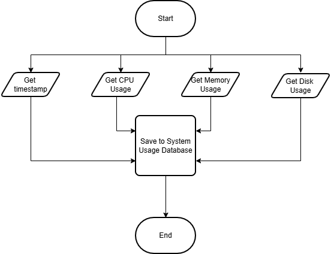
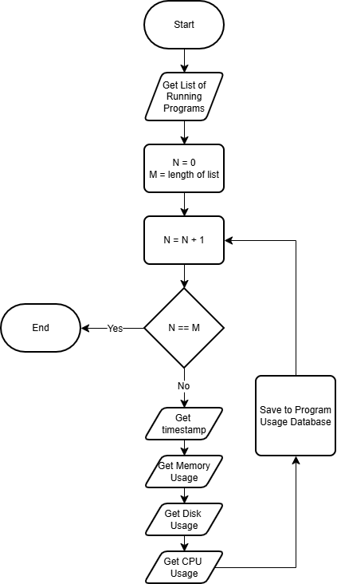

# System-Resource-Usage
a repository for scripts to retrieve and analyze system resource usage

## The Problem
Sometimes, the system of its resources but it's unclear what specific programs contribute to that usage. Task manager and resource manager don't show certain programs and don't allow for easy analysis of the data.

## How It Works
- Retrieve overall CPU, Memory, & Disk usage measurements
- Retrieve each program's usage measurements
- Insert data into their respective databases alongside timestamps




## Tech Stack
- **Language:** Python
- **Libraries:** PSUtil, SQLite3

## Setup
```bash
git clone https://github.com/RhinoX12345/System-Resource-Usage
cd System-Resource-Usage
```

## Usage
```bash
./system_monitor.py
./program_monitor.py
```

## Future features
- Continuous monitoring
- Pattern analysis from historical data